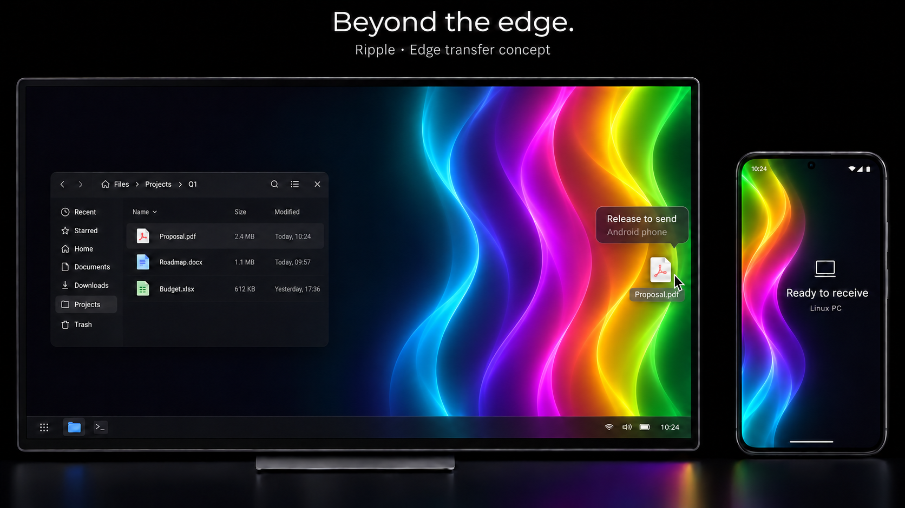

<div align="center">

# ripple

### Share files between your devices, simply and securely.

Move files between your Android phone and Linux desktop over your local network.
Pair once, stay in control, and keep the cloud out of the transfer.


[Explore features](#what-works-today) · [Get started](#get-started) · [Development board](#development-board) · [Contribute](#contributing)



</div>

---

## The idea

Ripple brings your phone and desktop together without requiring an account or an internet connection for file transfers. A Linux service handles trust and transfer state, while a Qt desktop app and a native Android companion give you control over what gets sent and where it lands.

> **Project status: active development.** The core pairing and bidirectional transfer flows are implemented. Ripple is not yet a finished release: background transfer, durable resume, AI features, broader device testing, and polished installation are still in progress or planned.

## What works today

| Area | Current capabilities |
| :--- | :--- |
| **Pairing & discovery** | Discover a PC on the local network, scan its QR invitation, and approve the Android device on the desktop. Trusted devices can reconnect after an address change. |
| **Secure connection** | TLS 1.3 with a pinned PC identity, Android Keystore keys, and signed requests from trusted Android devices. |
| **File transfers** | Send individual files in either direction using authenticated offers, bounded chunks, SHA-256 verification, and delivery receipts. |
| **Desktop → Android** | Choose or drop a file on the desktop, then accept it on Android or use the trusted-device auto-accept setting. |
| **Android → desktop** | Select a file in Android’s in-app browser; approve the incoming offer on the desktop or enable auto-accept for trusted devices. |
| **Receive & open** | Choose a receive folder on each device. Open received files with an installed application and review transfer history. |
| **Visual feedback** | Rainbow ripple feedback accompanies in-app drag interactions; it is feedback, not confirmation of delivery. |

### Current boundaries

- Android checks the PC for incoming offers while Ripple is open. An always-on listener and a foreground service for active transfers are not implemented.
- Desktop sending currently targets a **single paired Android device**; it is disabled when multiple devices are paired.
- Transfers use sequential **1 MiB chunks**, with a current **10 GiB per-file limit**. Durable resume after interruption is not available.
- File storage depends on Android document-provider capabilities; the selected Linux receive filesystem must support hard links for safe finalization.
- AI screens are placeholders. No AI provider or assistant functionality is implemented.
- Real-device and cross-platform testing is still needed before treating these flows as release-ready.

## Development board

| ✅ Implemented | 🚧 Needs further work | ◇ Planned |
| :--- | :--- | :--- |
| QR pairing & trusted identities | Physical-device interoperability and failure testing | Foreground execution for active Android transfers |
| Local discovery and encrypted transport | Transfer performance and large-file testing | Durable resume and interrupted-transfer recovery |
| Bidirectional single-file transfers | Android storage-provider and lifecycle coverage | Bounded transfer queue and broader multi-file workflows |
| Approval, trusted-device auto-accept, and receipts | Desktop packaging and installation experience | AI-assisted file questions and search |
| Receive folders and transfer history | Accessibility and desktop-session validation | Additional platforms and device workflows |

These columns describe the repository’s current state and direction, not a release schedule.

## How it fits together

```text
 Android phone                                  Linux desktop
┌───────────────────────┐                    ┌─────────────────────────┐
│ React + Capacitor UI  │                    │ Qt Quick desktop UI     │
│ Kotlin native bridge  │◄── signed HTTPS ──►│ Go service              │
│ Keystore + SAF        │     over local LAN │ pairing + transfer state│
└───────────────────────┘                    └─────────────────────────┘
```

Android initiates the network connection; the PC does not need to connect to a listening port on the phone. File bytes stay in the native transfer code rather than crossing the JavaScript bridge. See the [protocol](Linux/ripple/docs/protocol-v1.md) for the current wire contract.

## Tech stack

| Layer | Technologies | Responsibility |
| :--- | :--- | :--- |
| Android interface | React, TypeScript, Tailwind CSS, Vite | Screens, interaction, and application state |
| Android native | Capacitor, Kotlin, Android Keystore, Storage Access Framework | Device discovery, trust, native file access, and transfers |
| Desktop interface | Qt 6, Qt Quick/QML, C++ | Desktop controls, file picker, drag-and-drop, and local IPC |
| Desktop service | Go | Pairing, discovery, authenticated transfer endpoints, and transfer state |
| Connectivity | DNS-SD/mDNS, HTTPS, TLS 1.3, ECDSA P-256, SHA-256 | Local discovery, identity verification, and file integrity |

## Get started

### Prerequisites

| Android build | Linux build |
| :--- | :--- |
| Node.js 22+, npm, JDK 21, Android SDK | Go version declared in [`go.mod`](Linux/ripple/go.mod), Qt 6 development tools, qmake, C++17 compiler, GNU Make |
| Android device with API 26+ for running the app | Linux desktop with the Qt runtime available |

### 1. Build the Android app

From the repository root:

```sh
cd Android/ripple
npm ci
cp -a ../../native/android-template android
npm run build
npx cap sync android
cd android
./gradlew :app:assembleDebug
```

The debug APK is written to `android/app/build/outputs/apk/debug/app-debug.apk`. The `android` working directory is ignored: make permanent native changes in [`native/android-template`](native/android-template), then update your local Android project before syncing.

### 2. Build and run the Linux companion

```sh
cd Linux/ripple
make check
make build
./build/bin/ripple-desktop
```

Keep `rippled` next to `ripple-desktop`. The desktop starts its own service when needed; if one is already running, it connects to that service.

### 3. Pair and transfer

1. Connect your phone and PC to the same local network, or use a user-established hotspot.
2. Open Ripple on both devices. On the PC, generate a pairing QR code; scan it on Android and approve the request on the PC.
3. Choose a receive folder in each app’s settings. Select or drop a file and accept the offer on the receiving device, unless trusted-device auto-accept is enabled.

See the [Android guide](Android/ripple/README.md), [Linux guide](Linux/ripple/README.md), and [development notes](Linux/ripple/docs/development.md) for more detail.

## Repository map

| Path | What lives there |
| :--- | :--- |
| [`Android/ripple`](Android/ripple) | Android app UI, Capacitor bridge, and web tests |
| [`native/android-template`](native/android-template) | Maintained Android project and native implementation |
| [`Linux/ripple`](Linux/ripple) | Go service and Qt/QML desktop app |
| [`Linux/ripple/docs`](Linux/ripple/docs) | Protocol and development notes |
| [`.github/workflows`](.github/workflows) | Release artifact workflow |

## Releases

Publishing a GitHub release from a commit reachable from `main` triggers builds for an Android release APK and a Linux x86-64 archive. The APK is **unsigned** and must be signed before installation or distribution. The Linux archive contains binaries and requires compatible Qt runtime libraries; a polished installer is still planned.

## Contributing

Issues and focused pull requests are welcome. For a substantial change, open an issue first to discuss the problem and approach. Include the checks you ran and any device or environment limitations in your pull request.

| Platform | Useful checks |
| :--- | :--- |
| Android | `npm run check`, `npm run lint`, `npm test`, `npm run build`, and relevant Gradle checks |
| Linux | `make check`, the desktop build, and relevant integration checks |

Do not commit credentials, signing keys, device data, or generated builds. Please report security vulnerabilities privately to the maintainers instead of posting exploit details publicly.

---

<div align="center">

**Built for the space between your devices.**<br>
Licensed under [GNU GPL v3.0 only](LICENSE).

</div>
